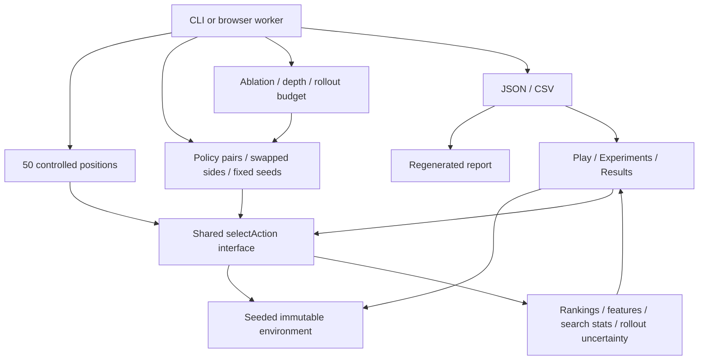

# Architecture

The core files use a small universal wrapper so the exact same code runs through normal browser script tags, a browser worker, and Node's CommonJS loader. This preserves direct-file play without a bundler or duplicate Python implementation.

- `engine.js` owns all state transitions and random chance outcomes. It has no DOM dependencies.
- `policies.js` implements the five policies and produces decision traces. It calls the engine for hypothetical moves.
- `evaluation.js` constructs scenario fixtures, runs games, aggregates metrics, and executes parameter studies. It yields between chunks when running without a worker.
- `app.js` handles rendering, turn feedback, animations, inspection, local storage and downloads. Abortable waits prevent old AI/animation callbacks from modifying a new game.
- `worker.js` isolates browser experiments from gameplay. Cancelling terminates the worker and discards partial results.
- `scripts/experiments.cjs` runs experiments from JSON configurations and saves measured outputs.
- `scripts/report.cjs` regenerates the linked HTML tables from saved outputs without rerunning experiments.
- `scripts/serve.cjs` serves the local app on loopback and chooses the next available port if necessary.

The engine and policy API are synchronous so tests and search share one contract. Tournament orchestration is asynchronous only for cancellation, progress updates and UI responsiveness. The engine's chance seed is separate from the policy/simulation seed. No results are prefilled or inferred from model names.
